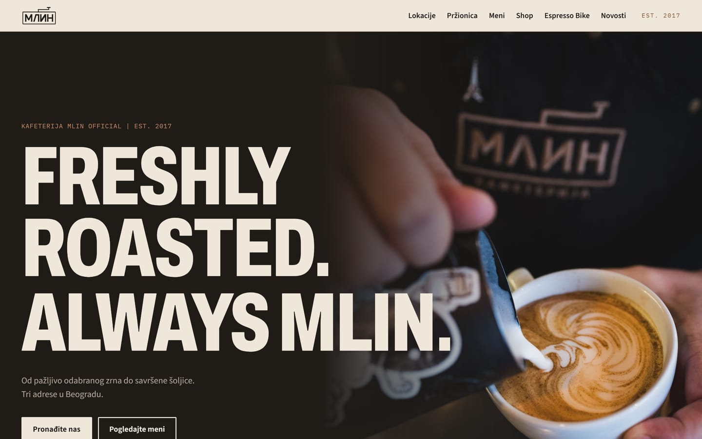
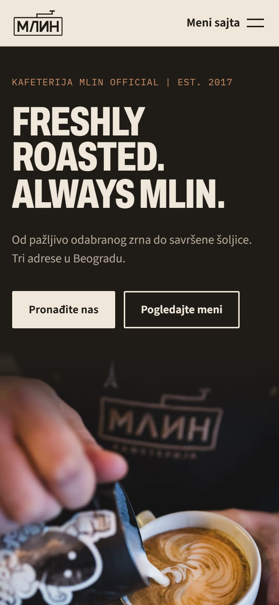

# Kafeterija Mlin · zvanični sajt

Kafeterija i pržionica kafe iz Beograda, EST. 2017. Tri zvanične lokacije: Voždovac (Kostolačka 79), Novi Beograd (Španskih boraca 3) i Terazije 2GO (Terazije 23).

**Live:** https://cheef30.github.io/kafeterija-mlin/

| Računar (1440 px) | Telefon (390 px) |
|---|---|
|  |  |

## Tehnologije
- [Astro 5](https://astro.build), statičan sajt, bez okvira na klijentu (oko 2 KB sopstvenog JS-a)
- Sadržaj u `data/*.json` (lokacije, meniji, Shop, novosti, kafe, recenzije, kontakt)
- Fotografije obrađene skriptom `scripts/build-images.mjs` ([sharp](https://sharp.pixelplumbing.com)): EXIF rotacija, uklanjanje EXIF/GPS, AVIF + WebP + JPG u 480 do 2400 px
- Fontovi self-hosted i subsetovani (`scripts/fonts.py`, fonttools): Archivo, Source Sans 3, IBM Plex Mono
- Wordmark МЛИН je SVG rekonstrukcija (`src/lib/wordmark.mjs`), verzije u `public/assets/`
- SEO: schema.org (Organization + 3 × CafeOrCoffeeShop), `sitemap.xml`, `robots.txt`, `llms.txt`, Open Graph
- Bez kolačića i bez trackera
- Objava: GitHub Actions → GitHub Pages (`.github/workflows/deploy.yml`)

## Lokalno pokretanje
```bash
npm install
npm run dev        # http://localhost:4321/kafeterija-mlin/
npm run build      # gradi dist/
npm run preview    # služi dist/
```

Pomoćne skripte (nisu potrebne za objavu, rezultat je već u repou):
```bash
npm run images     # nove fotografije iz slike/ → public/img/ (originali nisu u repou)
python scripts/fonts.py
node scripts/screenshots.mjs http://localhost:4321/kafeterija-mlin screenshots
```

## Izmene sadržaja
Videti [UPUTSTVO-ZA-IZMENE.md](UPUTSTVO-ZA-IZMENE.md). Ukratko: izmeni JSON u `data/`, commit + push, sajt se sam ažurira.

## Dokumenti
- [DESIGN.md](DESIGN.md): pojam, paleta, tipografija, raspored
- [slike/INVENTAR.md](slike/INVENTAR.md): pregled svih 74 fotografija od klijenta

Izrada sajta: [Stefan Stević](https://stefanstevic.rs/)
